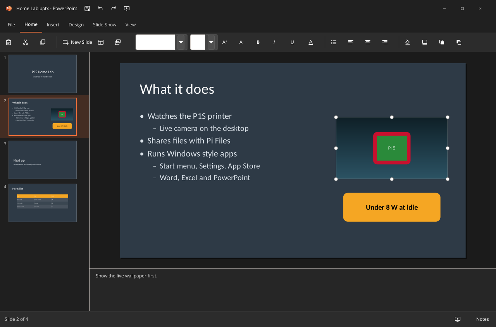
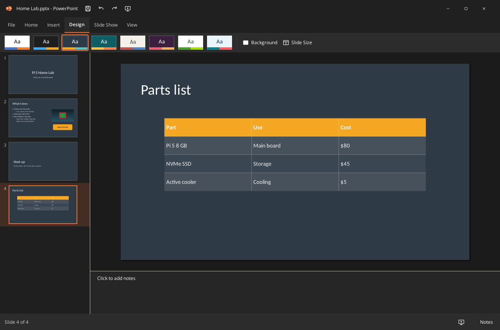

# pi-powerpoint

A Windows 11 style presentation app for the Raspberry Pi (built for the Pi 5, works on other Pis running Raspberry Pi OS). It opens and saves real **.pptx** files, which open in Microsoft Office, Google Docs/Sheets/Slides and LibreOffice. Native GTK app with the Windows 11 dark look, like the other Pi apps.



## Features

- **Slide list** on the left with live thumbnails; add, duplicate, delete and reorder slides (Ctrl+Up/Down)
- **Layouts**: Title Slide, Title and Content, Section Header, Two Content, Title Only and Blank
- **Type right on the slide**; bullets with levels (Tab / Shift+Tab), fonts, sizes, bold/italic/underline, colors, alignment
- **Pictures**, **shapes** (rectangle, rounded rectangle, oval, triangle, arrow, star, line), **text boxes** and **tables**
- Move and resize with the mouse, snap to the slide center and edges, arrow keys to nudge, bring to front / send to back
- **Design themes** (Office, Dark, Slate, Ion, Paper, Berry, Fresh, Sky), background colors, 16:9 or 4:3 slides
- **Speaker notes** under each slide
- **Slide show** full screen from the beginning (F5) or the current slide (Shift+F5), with a fade between slides
- **Export as PDF**



## Install

In a terminal on the Pi (as your normal user, not with sudo):

```
git clone https://github.com/wvfouram/pi-powerpoint.git && bash pi-powerpoint/install.sh
```

Then open **PowerPoint** from the menu, or run `pi-powerpoint`.

Becomes the default app for .pptx files. Uninstalling puts the previous app back.

To update later:

```
cd ~/pi-powerpoint && git pull && bash install.sh
```

## Keyboard shortcuts

| Keys | Action |
|---|---|
| Ctrl+N / Ctrl+O | New / Open |
| Ctrl+S / Ctrl+Shift+S | Save / Save as |
| Ctrl+M | New slide |
| F5 / Shift+F5 | Slide show from the start / this slide |
| Arrows, Space, click | Next / previous slide in the show |
| Esc | End the show |
| Ctrl+C / X / V / D | Copy / Cut / Paste / Duplicate |
| Delete | Delete the selection |
| Tab / Shift+Tab | Bullet level (while typing) or next shape |
| Ctrl+B / I / U | Bold / Italic / Underline |
| Ctrl+Z / Ctrl+Y | Undo / Redo |
| Ctrl+P | Export as PDF |

## Uninstall

```
bash pi-powerpoint/uninstall.sh
```

## License

MIT

This is an independent hobby project. It is not made by, affiliated with or endorsed by Microsoft. Word, Excel and PowerPoint are trademarks of Microsoft.
